# fastapi-rag-audit-service


A small, on-premise-style document Q&A service: upload an Excel or CSV file, search it in natural language, and get back the matching rows **with their source (file and row number)**. Every question is written to an **audit log**.

It is a learning prototype that mirrors the core ideas of private RAG (Retrieval-Augmented Generation) systems used in compliance-heavy environments: data stays on your own infrastructure, answers are traceable to a source, and every query leaves an audit trail.

> **Status:** prototype / portfolio project. It implements the **retrieval** part of RAG (TF-IDF). There is no LLM generation and no real authentication yet; see [Limitations](#limitations) and [Roadmap](#roadmap).

---

## Features

- **Upload** `.xlsx` or `.csv` files and get an instant **data-quality profile** (row count, columns, percentage of missing values per column)
- **Retrieval with sources**: every result carries `source` (file name), `row` (row number in the original sheet) and a similarity `score`
- **Audit log**: every question is appended to `data/audit.jsonl` with time (UTC), user, question and the sources returned
- **Structured analysis**: average of a numeric column grouped by another column (for example, average resolution time by priority)
- **Excel export** of the grouped result
- **Runs fully offline**: no external API calls, no model downloads
- **Dockerized**, with the data folder mounted as a volume so the audit log survives container restarts
- **Interactive API docs** (Swagger UI) generated by FastAPI
- **Automated tests** with pytest

---

## How it works

```
Excel / CSV
    │
    ▼
 ingest.py     profile the data + split the table into chunks (1 row = 1 chunk)
    │
    ▼
 retrieval.py  TF-IDF index (scikit-learn), cosine similarity search
    │
    ▼
 main.py       FastAPI routes: /documents, /ask, /stats, /export, /health
    │
    ▼
 audit.py      append every query to data/audit.jsonl
```

Each chunk keeps its origin (`source` and `row`), which is what makes every answer traceable.

---

## Tech stack

| Tool | Role |
|------|------|
| **Python 3.12** | Application code |
| **FastAPI** | REST API, request validation, automatic OpenAPI / Swagger docs |
| **Uvicorn** | ASGI server |
| **pandas + openpyxl** | Reading Excel/CSV, profiling, grouped statistics, Excel export |
| **scikit-learn** | TF-IDF vectorization and cosine similarity (retrieval) |
| **Pydantic** | Request models and validation (built into FastAPI) |
| **pytest + httpx** | API tests (`TestClient`) |
| **Docker** | Containerization, volume for persistent data |

---

## API endpoints

| Method | Route | Description |
|--------|-------|-------------|
| `GET` | `/health` | Liveness check, returns `{"status": "online"}` |
| `POST` | `/documents` | Upload `.xlsx` / `.csv`, returns the data profile and builds the in-memory index |
| `POST` | `/ask` | Search the uploaded document; returns matching rows with sources and logs the query. Optional header `x-user` |
| `GET` | `/stats/{column}` | Summary of a column; with `?group_by=<column>` returns the average per group |
| `GET` | `/export` | Same grouped average as an Excel download (`?column=...&group_by=...`) |

Status codes used: `200` success, `400` unsupported file type, `404` unknown column (`/stats`), `409` no document loaded yet, `422` invalid request.

Interactive documentation: **http://127.0.0.1:8000/docs**

---

## Getting started

### Option 1: Run locally

**Windows (PowerShell or cmd):**

```
python -m venv .venv
.venv\Scripts\activate
pip install -r requirements.txt
uvicorn app.main:app --reload
```

**macOS / Linux:**

```bash
python -m venv .venv
source .venv/bin/activate
pip install -r requirements.txt
uvicorn app.main:app --reload
```

Open http://127.0.0.1:8000/docs. The sample data is already in `data/support_tickets.xlsx`; to regenerate it, run `python make_sample_data.py`.

### Option 2: Run with Docker

Build the image:

```
docker build -t fastapi-rag-audit-service .
```

Run the container (the `data` folder is mounted so the audit log persists):

| Terminal | Command |
|----------|---------|
| **PowerShell** | `docker run -d --rm -p 8000:8000 --name rag-audit -v "${PWD}/data:/code/data" fastapi-rag-audit-service` |
| **cmd** | `docker run -d --rm -p 8000:8000 --name rag-audit -v "%cd%/data:/code/data" fastapi-rag-audit-service` |
| **bash** | `docker run -d --rm -p 8000:8000 --name rag-audit -v "$(pwd)/data:/code/data" fastapi-rag-audit-service` |

Useful commands:

```
docker ps                                  # is it running?
docker logs rag-audit                      # server logs
docker exec -it rag-audit bash             # shell inside the container
docker stop rag-audit                      # stop (container is removed because of --rm)
```

Notes:
- The container starts Uvicorn with `--host 0.0.0.0`, which is required for the API to be reachable from outside the container.
- After a restart the in-memory index is empty, so upload the document again (`POST /documents`). Files in `data/` persist.

### Run the tests

```
python -m pytest -q
```

---

## Example usage

The easiest way is the Swagger UI at `/docs`: **Try it out**, then **Execute**. With `curl` (bash, or `curl.exe` in PowerShell):

```bash
# 1. Upload a document
curl -X POST http://127.0.0.1:8000/documents -F "file=@data/support_tickets.xlsx"

# 2. Ask a question
curl -X POST http://127.0.0.1:8000/ask \
  -H "Content-Type: application/json" -H "x-user: Ivana" \
  -d '{"question": "billing invoice mismatch", "top_k": 3}'

# 3. Average resolution time per priority
curl "http://127.0.0.1:8000/stats/ResolutionHours?group_by=Priority"

# 4. Export the same result as Excel
curl -o export.xlsx "http://127.0.0.1:8000/export?column=ResolutionHours&group_by=Priority"
```

**Upload response** (`POST /documents`):

```json
{
  "filename": "support_tickets.xlsx",
  "profile": {
    "rows": 500,
    "columns": ["TicketNumber", "Priority", "Channel", "ProductArea", "Summary", "ResolutionHours"],
    "missing_percent": { "ResolutionHours": 5.4 }
  }
}
```

**Ask response** (`POST /ask`, shortened):

```json
{
  "question": "billing invoice mismatch",
  "answer": "Pronadjeno 2 relevantnih redova u 'support_tickets.xlsx'.",
  "sources": [
    {
      "source": "support_tickets.xlsx",
      "row": 5,
      "text": "TicketNumber: TCK-000004 | Priority: P1 | Channel: Phone | ProductArea: Billing | Summary: Billing invoice mismatch detected",
      "score": 0.502
    }
  ]
}
```

The `answer` text is a placeholder (there is no LLM generation yet); the value of the response is the list of `sources`.

---

## Audit log

Every call to `/ask` appends one line to `data/audit.jsonl` (JSON Lines format, one event per line):

```json
{"time": "2026-10-11 00:48:00 UTC", "user": "Ivana", "question": "billing invoice mismatch", "sources": [{"source": "support_tickets.xlsx", "row": 5}, {"source": "support_tickets.xlsx", "row": 332}]}
```

- Timestamps are in **UTC**, so logs from different servers are comparable.
- The file is opened in append mode and is never rewritten by the application.
- In Docker, `data/` is mounted as a volume, so the log lives outside the container and survives restarts and upgrades.

---

## Screenshots

**Docker: image build and container run:**

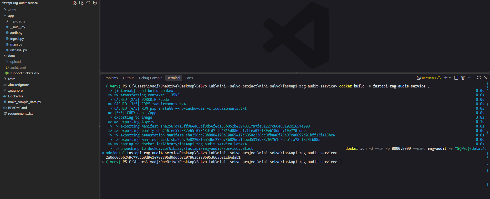

**Running container** (`docker ps`):

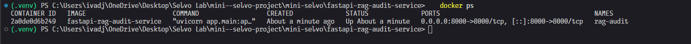

**Docker Desktop:**

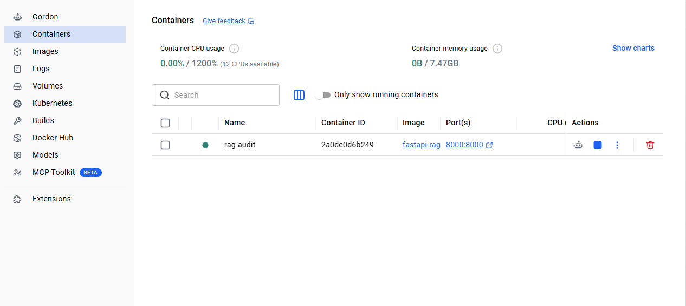

**Swagger UI:**

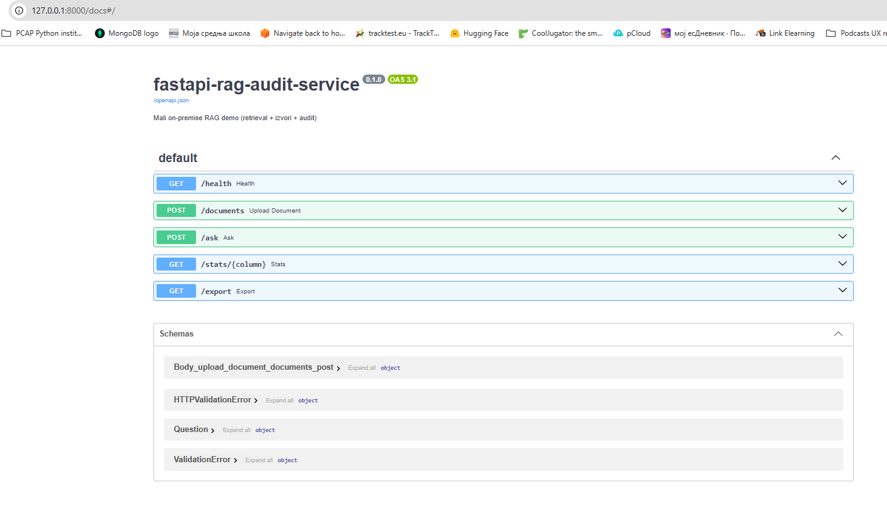

**Upload response with data profile** (`POST /documents`):

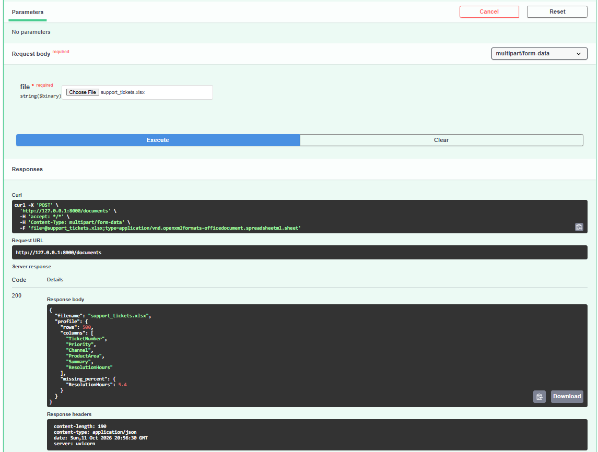

**Ask response with traceable sources** (`POST /ask`):

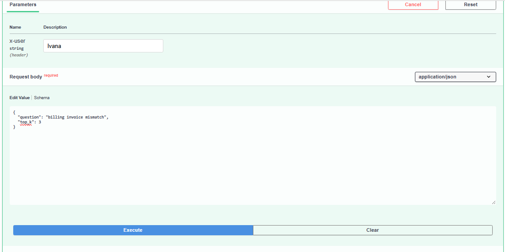

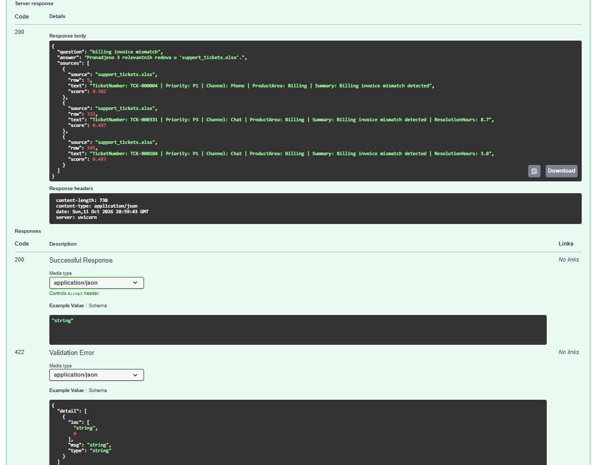

**Audit log written by the container to the mounted volume:**

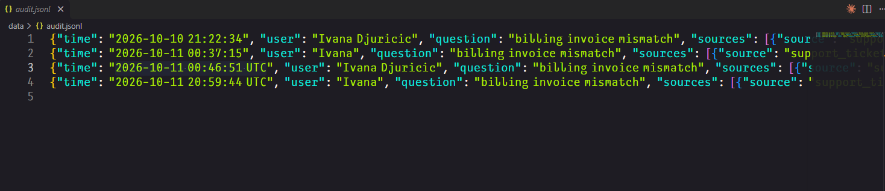

**Grouped statistics** (`GET /stats`):

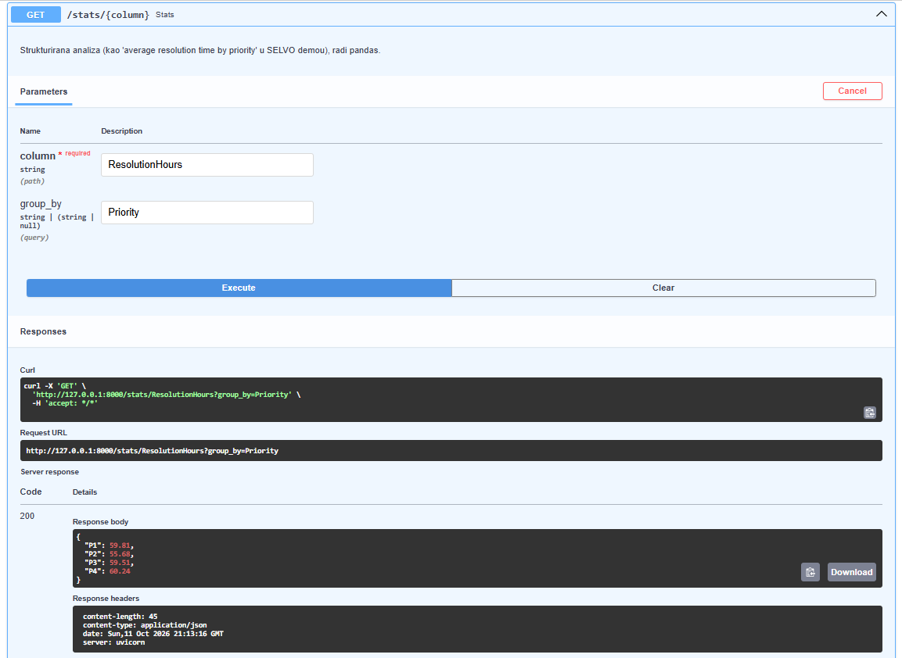

**Excel export** (`GET /export`):

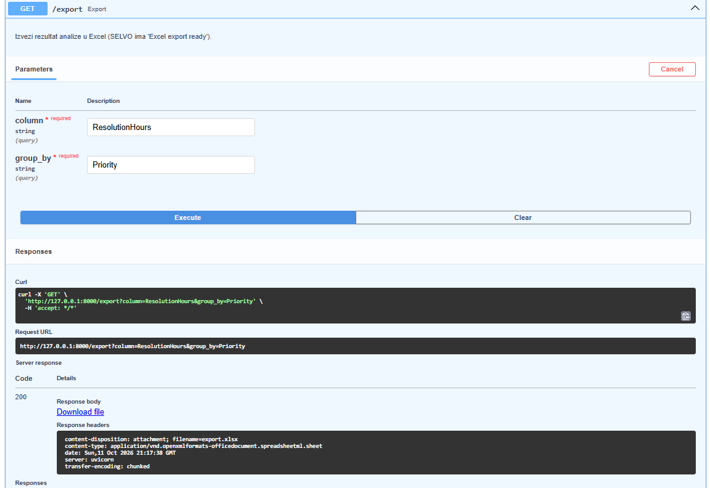

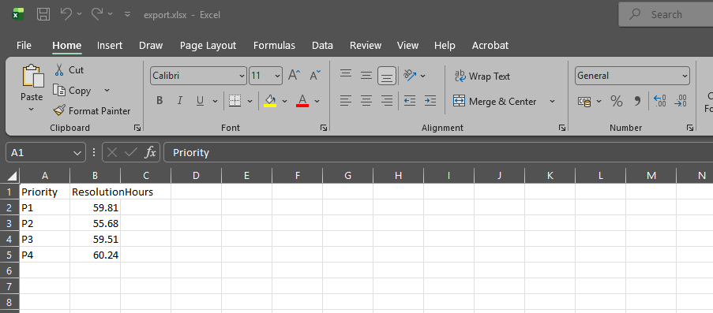

---

## Project structure

```
fastapi-rag-audit-service/
├── app/
│   ├── __init__.py
│   ├── main.py              ← FastAPI app and routes
│   ├── ingest.py            ← load Excel/CSV, data profile, chunking
│   ├── retrieval.py         ← TF-IDF index and search
│   └── audit.py             ← append-only JSONL audit log
├── data/
│   └── support_tickets.xlsx ← synthetic sample data (500 tickets)
├── docs/
│   └── screenshots/         ← Docker, Swagger and audit log screenshots
├── tests/
│   └── test_api.py          ← API tests (pytest)
├── .dockerignore
├── .gitignore
├── Dockerfile
├── make_sample_data.py      ← generates the synthetic dataset
├── requirements.txt
└── README.md
```

Generated at runtime and not committed: `data/uploads/` (uploaded files) and `data/audit.jsonl` (audit log).

---

## Design notes

- **TF-IDF instead of embeddings**: it runs 100% locally with no model download, which fits the on-premise idea and keeps the prototype simple. The `Index` class has a small interface (`search(question, top_k)`), so TF-IDF can be replaced by an embedding model and a vector store without changing the API routes.
- **One row = one chunk**: for tabular data a row is the natural unit, and it keeps the exact row number for traceability.
- **Sample data is synthetic and random**: the numbers (for example, the averages per priority) only demonstrate that the routes work and carry no business meaning.
- **Append-only audit file + volume**: the audit trail must outlive containers.

---

## Limitations

- Retrieval only: no LLM generates the answer yet
- TF-IDF compares words, not meaning (for example, "bill" will not match "invoice")
- The loaded document and index are stored in the memory of the server process, so they are shared by all users and lost on restart
- `x-user` is a plain header and is **not authenticated**; the audit log is only as reliable as that identity
- `/stats` and `/export` expect a numeric column when grouping; `/export` does not validate column names yet
- Prototype for learning and demonstration, **not production-ready**

---

## Roadmap

- [ ] Embeddings + vector store (for example pgvector, Qdrant or MongoDB Vector Search) instead of TF-IDF
- [ ] Local LLM for generation (for example via Ollama), answering only from retrieved sources with citations
- [ ] Real authentication (OIDC / JWT) and role-based access control
- [ ] Persistent storage (PostgreSQL) instead of in-memory state
- [ ] Reverse proxy with TLS in front of the API
- [ ] Tamper-evident, append-only audit storage
- [ ] PDF and Word support
- [ ] CI with GitHub Actions (tests and Docker build)

---

## Related project

[**movies-etl-pipeline**](https://github.com/ivanadjuricic/movies-etl-pipeline): end-to-end data engineering project with AWS S3, PostgreSQL, dbt, Airflow and Docker Compose.

---

## Author

**Ivana Đuričić**

[GitHub](https://github.com/ivanadjuricic) | [LinkedIn](https://www.linkedin.com/in/ivanadjuricicvisualdesign772025/)
